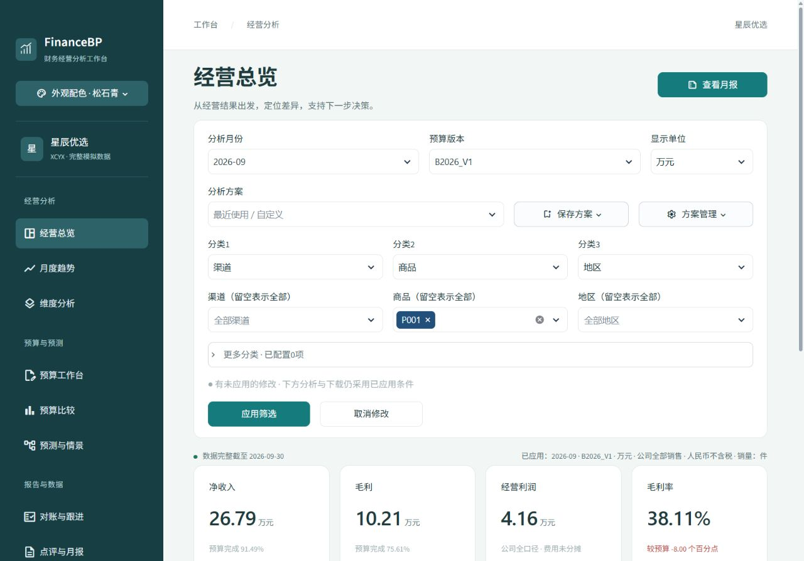

# FinanceBP · 财务经营分析桌面应用

**Windows 11 x64｜1.2.2 体验版｜安装后点击桌面图标使用**

从订单文件接入、动态分类，到经营分析、预算预测及可追溯月报，在一个独立窗口中完成。内置“星辰优选”模拟企业，安装后即可体验。

## 下载并安装

### [⬇ 下载 Windows 1.2.2 安装包 EXE · 约 298 MiB](https://github.com/nixizoul0017/FinanceBP/releases/download/v1.2.2-rc.1/FinanceBP-1.2.2-windows-x64-setup.exe)

[版本说明及全部附件](https://github.com/nixizoul0017/FinanceBP/releases/tag/v1.2.2-rc.1) · [安装与使用指南](docs/WINDOWS_APP.md) · [模拟数据说明](docs/DEMO_DATA.md)

1. **下载** `FinanceBP-1.2.2-windows-x64-setup.exe`。
2. **双击安装**，按向导完成安装，保留“创建桌面快捷方式”选项。
3. **点击桌面 FinanceBP 图标**，等待分析页面就绪后使用。以后仍点击同一个图标。

**无需另装 Python、Excel 或 MySQL，无需手动启动服务或输入网址。** 安装程序包含 Python 3.13、应用依赖和 WebView2 离线组件。内置模拟数据可离线分析；连接远程企业数据库时需要网络、账号及接入配置。目前不提供 Mac 应用安装包。

已有旧版：先关闭 FinanceBP，可通过“文件”菜单备份个人数据，再运行新版安装器更新，从原桌面图标打开。升级与卸载默认保留个人数据，业务来源文件需自行保管。

> **当前为未签名体验版（预发布 `v1.2.2-rc.1`），应用内部版本1.2.2。** 1.2.1—1.2.2未重跑全套功能、冻结EXE或安装后验收；1.2.2仅完成指定文件的针对性接入核对。独立干净Windows、完整原生窗口及125%/150%缩放等仍待验收。历史测试数量不能视为本版全部通过。详见[实际验收记录](docs/WINDOWS_ACCEPTANCE.md)。不要为安装关闭系统安全功能。

“Code → Download ZIP”和源码ZIP面向学习与开发；**普通用户下载上方EXE即可**。[旧1.0体验版](https://github.com/nixizoul0017/FinanceBP/releases/tag/v1.0.0-rc.1)保留，不覆盖历史附件。

## 1.2.2新增与累计改进

- **直接导入业务文件**：支持Excel（xlsx/xls/xlsm）、Stata DTA、CSV、TSV及记录JSON，可多选文件和工作表，不必先编写配置JSON。
- **按表头配置分类**：选择表头行，默认第1行；全部字段均可勾选为分类并改名，保留确认操作，后续在“分类与映射”继续修改。MySQL也支持按表、按列接入。
- **首次订单导入更直接**：推荐订单、支付/销售日期、金额、所属月份与少量分类，用户核对后应用；普通分类与财务含义分别确认。
- **编号与日期兼容**：一单一行时只选择一次“订单编号（唯一明细编号）”；多明细可用高级选项分别指定。支付时间支持时分秒、中文冒号及原生日期时间。
- **数量可默认1**：没有数量列时每条明细按1计数；映射实际列后使用原值并继续校验。单日或部分期间可核对文件内已知交易，不外推整月，不补造成本、费用或预算。
- **修复导入等待遮罩**：等待文件、字段确认或期间设置时，不再持续遮挡输入。仍保留三种配色、统一应用筛选与原高级JSON入口。

[文件导入步骤与边界](docs/FILE_IMPORT.md) · [表头分类与映射](docs/HEADER_CATALOG.md) · [全部版本变化](CHANGELOG.md)

## 界面与完整功能

界面可切换**深海蓝、松石青、石墨紫**。月份、预算、分类与对象先选择，再点击“应用筛选”统一生效；列表的打开、搜索或关闭不会重新计算整个分析页面。

| 功能页面 | 主要用途 |
|---|---|
| 经营总览 | 净收入、成本、毛利、公司费用、经营利润、预算完成与累计 |
| 月度趋势 | 环比、同比、累计及历史实际变化的驱动拆解 |
| 维度分析 | 自选商品、部门、销售员等维度，筛选与多个维度联合汇总 |
| 预算工作台 | 金额/驱动模板、导入校验、草稿、发布与调整版本 |
| 预算比较 | 销量、结构、均价、成本、退款及费用差异定位 |
| 预测与情景 | 三种历史方法、回测、未来预测、假设比较与版本保存 |
| 对账与跟进 | 来源/分析核对、独立依据、月份确认、异常负责人及行动记录 |
| 点评与月报 | 事实点评、10张工作表的Excel月报、Markdown及精确JSON |
| 数据与下载 | 数据质量、字段映射、完整性及销售/退款/费用/分类明细 |

分类与方案按企业和稳定接入配置隔离；记忆分类顺序与分组，支持方案保存、更新及导入导出，不长期保存具体对象或密码。数据库没有预算时，可在本机预算工作台编制，不写回企业SQL。

## 先体验“星辰优选”模拟企业

默认选择 **完整模拟数据**，即可查看经营结果。也可切换以下样本，默认文件演示无需MySQL：

| 样本 | 用途 |
|---|---|
| 完整模拟数据 | 2024年1月至2026年9月，5万条原始订单明细，含退款、费用和2026年预算 |
| 多维模拟数据 | 部门、销售员、门店、客户类型，以及调岗、缺失归属与预算粒度差异 |
| 异名模拟数据 | 不同表名、字段名表达相同业务，用于验证映射 |
| 小样本核对 | 可逐笔计算的交易与跨月退款，便于学习和复核 |

**企业、客户、员工及交易全部为人工模拟，不含真实企业交易或客户隐私。** 样本、公开配置、SQL及生成脚本纳入完整源码ZIP，安装包内置体验所需样本。位置、字段、行数、种子和校验方法见[模拟数据说明](docs/DEMO_DATA.md)。模拟场景不能作为真实企业经营结论。

## 个人数据、导出与财务边界

- 个人预算、对账、方案、偏好及预测版本保存在 `%LOCALAPPDATA%\FinanceBP`。通过“文件”菜单备份、恢复、导入旧项目或打开目录；备份不含企业业务文件和数据库密码，换机需另带来源文件或可用连接。
- 桌面导出打开系统“另存为”；Excel是当次已应用条件的快照，修改范围或假设后重新生成。上传、个人配置、密码、日志和实际订单不进入公开项目包。
- 当前财务模板为人民币元、不含税的自营商品销售。确认销售日、税口径及数据粒度仍需用户核对；只读企业来源，不自动改写源文件或数据库。
- 退款按发生月扣减并沿用原销售归属；公司费用和经营利润保持公司口径。没有销售员预算不生成该粒度预算；历史不足不套用公司预测；缺必要来源不按0处理。
- 点评使用事实模板；预算、预测和异常记录用于单机管理分析，不等同企业权限审批或审计意见。

[完整使用指南](docs/USER_GUIDE.md) · [财务工作流程](docs/reference/finance_workflow.md) · [动态分类与方案](docs/reference/dynamic_dimensions.md) · [财务口径](docs/reference/financial_rules.md)

## 源码、学习与开发

本次Release同时提供**完整源码ZIP（含全部模拟数据）**、Windows安装器，以及两者的SHA256文件。源码仓库排除个人记录、密码、本机环境、生成报告及构建缓存；不新增开源授权条款。

- [源码运行说明](docs/SOURCE_RUN.md)：Python环境、Windows/Mac源码入口与浏览器模式。
- [开发与维护指南](docs/DEVELOPMENT.md)：测试、构建、打包和后续发布。
- [验收清单](docs/WINDOWS_ACCEPTANCE.md) · [项目日志](docs/PROJECT_LOG.md) · [文档首页](docs/README.md)。

普通用户的日常入口是 **安装后的桌面 FinanceBP 图标**。
