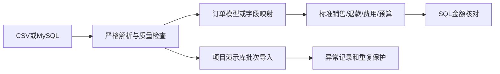

# 阶段5：Python读取、校验、导入与通用接入

> 阶段原始档案：保留当时的任务、决定和验证记录。当前使用方法见[使用指南](../../USER_GUIDE.md)，持续更新见[项目日志](../../PROJECT_LOG.md)。文中的阶段输出路径属于历史记录。


本阶段程序、完整模拟数据和独立MySQL验证已完成。你不需要先填写文档；先运行现成入口，再按下方顺序理解代码。现有电脑的项目Python环境已经准备好。

## 1. 这一步解决什么

阶段4是你执行SQL得到答案；阶段5让程序自动读取数据，检查能否用于分析，转换成统一格式，并留下处理记录。最终的网页、完整财务函数、PVM和预测分别在后续阶段实现。



两个入口用途不同：企业来源读取使用只读事务；模拟数据导入只允许带项目标记的finance_bp_demo系列演示库。

## 2. 先运行文件模式

在PowerShell执行：

```powershell
# 将下一行替换成自己电脑的项目目录
Set-Location -LiteralPath '<项目目录绝对路径>'
powershell -NoProfile -ExecutionPolicy Bypass -File '.\scripts\run_stage5.ps1' -Mode demo
```

预期末尾出现`STAGE5_FILES_COMPLETED`，说明34项小样本基准一致、33个月完整数据可读取、异名来源逐行一致。文件模式不需要数据库密码。

查看：

- `outputs/stage5/sample_python_vs_sql.json`：小样本逐项核对，9月净收入3240、净成本2055、毛利1185、费用400、利润785元。
- `outputs/stage5/demo_monthly.json`：完整历史的公司月度核对结果，金额以精确小数字符串保存。
- `outputs/stage5/offline_validation.json`：记录数、覆盖范围、功能条件、两套来源核对和本次耗时。

不要把小样本的3240元与完整模拟数据的公司收入直接比较。它们是不同的数据集，分别承担正确性核对和完整经营场景演示。

## 3. 第一个Python学习练习

```powershell
.\.venv\Scripts\python.exe .\scripts\learn_stage5.py
```

预期输出全部订单10、确认订单8、确认明细9。商品退款前收入分别为3850、60、240元，总计4150元。这时还没有扣退款910元，净收入才是3240元。

读`scripts/learn_stage5.py`，按顺序理解：

| Python写法 | 在做什么 | 对应SQL |
|---|---|---|
| `pd.DataFrame(...)` | 将一组记录变成有列名的数据表 | 查询结果表 |
| `orders[orders['order_status']=='completed']` | 筛选确认订单 | WHERE |
| `items.merge(..., on='order_id')` | 关联明细与订单 | JOIN ON |
| `validate='many_to_one'` | 确认订单端的order_id唯一，防止连接放大金额 | 连接行数检查 |
| `detail['sales_revenue']=...` | 新建计算列 | SELECT表达式 |
| `groupby('product_id').sum()` | 商品分组汇总 | GROUP BY、SUM |

一行明细可以对应一张订单，订单可以有多行明细，所以是many_to_one。不能把退款直接合并到成交明细后再相加销售额；一条销售存在多次退款时会重复销售金额。

可选的分步练习见`notebooks/阶段5_Python读取与校验.ipynb`。不安装Notebook工具也可以阅读其内容，直接运行上面的学习脚本即可完成基础练习。

## 4. 怎样处理钱、日期和错误行

`src/etl/validation.py`将金额转成`Decimal`、日期转成`date`、数量转成整数。CSV先按文本读取，再逐项解析，保留商品编码前导零，也避免金额先变成二进制浮点数。

例如：`Decimal('120.00') * 5 - Decimal('50.00')`精确等于550.00元。真实金额不使用浮点随机数直接累计；模拟生成的抽样权重允许使用浮点，生成金额会按明确规则转为精确小数。

校验包含：必填与长度、整数和金额精度、真实日历日期、状态和确认日期、商品/客户/订单引用、折扣上限、退款时点、累计退货/退款上限、可回库数量与历史成本转回。

缺少关键收入或金额会拒绝该行。缺少成本的直接映射来源可以读取收入，但`margin`和`company_profit`功能条件为false，不把成本补0。

每个异常批次报告保留`row_number`、`reason`和原始行。CSV的row_number从第一条数据记录开始，表头不计入；不是物理文件行号，多行引号字段应按记录理解。

已生成的验收例子在`outputs/stage5/validation_imports/`：日期为2024-02-30的客户被拒绝，另一条合法客户正常进入；相同商品ID改写名称被识别为冲突。

## 5. 本机MySQL读取练习

确认文件模式成功后执行：

```powershell
powershell -NoProfile -ExecutionPolicy Bypass -File '.\scripts\run_stage5.ps1' -Mode mysql-read
```

入口读取`configs/sample_mysql.example.json`中的127.0.0.1:3306、root和finance_bp_stage3。密码在终端本地输入，不回显、不保存，不需要在聊天里发送。

预期`STAGE5_MYSQL_COMPLETED`；报告是`outputs/stage5/local_mysql_validation.json`。这一步读取原表，不依赖创建企业分析视图。

主机/账号不同才需要复制配置为`configs/你的名称.local.json`并修改非敏感连接项，再用`-Profile`指定。`.local.json`已从Git排除；模板和程序中不写密码。

## 6. 可选：把完整数据装入项目演示库

```powershell
powershell -NoProfile -ExecutionPolicy Bypass -File '.\scripts\run_stage5.ps1' -Mode mysql-import
```

它新建或复用本项目带标记的finance_bp_demo，导入8个CSV来源，立即再次导入同一批文件以检查重复保护，再对照文件标准数据。

如果已有同名库但没有本项目标记，会停止。可以在本地配置中改成finance_bp_demo_001等新名称；程序不会删除或清空已有库。创建演示库需要相应数据库权限。入口不改写finance_bp_stage3小样本。

批次规则：

- 同一数据类型、同一文件内容哈希、已成功：跳过，不增加业务行。
- 不同文件，同一业务ID且内容相同：跳过该行。
- 同一业务ID但内容不同，或另一ID重复同一费用来源凭据：拒绝，不覆盖历史。
- 数据行可隔离的问题：好行提交，坏行记录，状态completed_with_errors。
- 数据库/事务失败：整个文件的业务写入回滚，accepted_rows为0，另记failed批次；同文件重试复用batch_id并增加attempt_count。

所有成功批次满足`source_rows = accepted_rows + rejected_rows + skipped_rows`。重复执行已经含错误的文件不会重新处理坏行，应修正文件内容后形成新批次；报告会提示此前拒绝的行数。

这是项目演示库的单写入流程，使用MySQL命名锁串行导入；不负责协调其他企业系统同时写业务表。一次调用按文件事务提交，不是整个8文件目录一起回滚；重跑可从已完成文件继续。

## 7. 完整模拟数据是什么

数据位于`data/demo/`，随机种子20261012，实际2024-01至2026-09共33个月：20个商品、3个渠道、4个区域、3000个客户、35056个订单、50000条原始明细、47535条确认销售、2390次退款、363条费用；2026全年有2880条销售预算和132条费用预算。

`manifest.json`保存参数、记录数和来源文件SHA256；`scenario_truth.json`保存预设变化，供验收使用。分析和预测不能读取预设原因文件来生成结论。

变化包括6月/11月旺季、2026年3月收纳商品成本上涨、7月C01促销和营销费用增加、C02份额下降、8月厨房商品R04退款概率上升。概率抽样存在波动，后续要用实际数字核对变化。

2026预算来自2025同月实际和冻结假设，采用B2026_V1。2026年10—12月只有预算，没有未来实际；截止日后未发生的退款不会进入实际。

需要重新生成时：

```powershell
.\.venv\Scripts\python.exe .\scripts\generate_demo_data.py --lines 50000 --seed 20261012
```

这会覆盖`data/demo/`的模拟文件并更新非敏感配置。改变种子/规模后应使用新演示库，避免新数据与旧库同ID冲突。阶段3小样本保留。

## 8. 表名与字段名不同，怎样接入

`configs/demo_files.json`使用订单模型：数量×价格−折扣算销售收入，数量×历史单位成本算成本。

`configs/demo_renamed_files.json`使用直接映射：另一套数据的`b_sale_line_id`映射为标准`sale_line_id`，`b_sales_amount_before_refund`提供已扣折扣、未扣退款的金额。对应的MySQL模板为`demo_renamed_mysql.example.json`。

映射方向是“标准字段：原始字段”。每张表还可配置`value_maps`转换维度编码；存在未映射值就停止。例如标准字段channel_id的原值“直营网店”映射C01。业务语义必须先确认，字段名称相似不能证明金额同口径。

读取任意已有配置的样本预览：

```powershell
powershell -NoProfile -ExecutionPolicy Bypass -File '.\scripts\run_stage5.ps1' -Mode preview -Profile '.\configs\demo_renamed_files.json'
```

报告包含每类前5行、身份、规则版本、覆盖范围、能力条件及来源/内容指纹。企业ID加入所有标准业务键，内容更新也改变指纹，供后续网页隔离缓存。当前没有网页切换界面。

第一版支持类似商品销售的人民币不含税口径，MySQL和CSV/JSON来源。订单模型固定为本项目8类原表结构；不同源字段可以映射，但复杂关联、汇总粒度、已净额退款、其他税制/币种或行业规则需要另写并验证适配器。首次接入要人工确认覆盖范围、粒度和字段语义。

第二套MySQL异名表已在临时实例实际验证；普通mysql-import只装第一套8表，不会在用户库另外创建biz_系列演示表。

## 9. 建议阅读顺序与小练习

1. `scripts/learn_stage5.py`：理解DataFrame、筛选、merge和groupby。
2. `src/etl/validation.py`：解释退款为何需要跨行累计，而不是仅检查当前一行。
3. `src/etl/ingest.py`：理解批次、SHA256、事务、跳过和拒绝的区别。
4. `src/etl/sources.py`和两个配置：指出同一标准收入是如何从不同来源得到的。
5. `src/etl/checks.py`：观察销售和退款先形成独立事件，再汇总，费用单独聚合。

你可以只把学习脚本的商品分组改成channel_code，预期退款前C01为3300、C02为610、C03为240元。该练习输出退款前毛利，不代表渠道分摊净利润。

本阶段理解后，下一步是阶段6：标准数据输入下的正式财务函数，统一期间/维度筛选、同比环比/YTD、预算差异和缺失边界。

## 10. 换电脑时

当前验证环境为Windows、Python3.14.7。复制程序、docs、configs、data、sql、tests、scripts和requirements.txt；不要复制旧电脑的.venv或密码。新电脑准备Python3.14后运行：

```powershell
powershell -NoProfile -ExecutionPolicy Bypass -File '.\scripts\setup_python.ps1' -PythonPath '新电脑上的python.exe完整路径'
```

随后运行文件模式。不依赖MySQL即可核对模拟数据；需要数据库时另设本地凭据和可访问连接。完整网页和独立电脑迁移验收在阶段7、11继续。

学习依据：[Pandas读取CSV](https://pandas.pydata.org/docs/reference/api/pandas.read_csv.html)、[Pandas读取SQL及coerce_float参数](https://pandas.pydata.org/docs/reference/api/pandas.read_sql_query.html)、[SQLAlchemy连接与URL.create](https://docs.sqlalchemy.org/en/20/core/engines.html)、[PyMySQL认证依赖](https://pymysql.readthedocs.io/en/latest/user/installation.html)。
