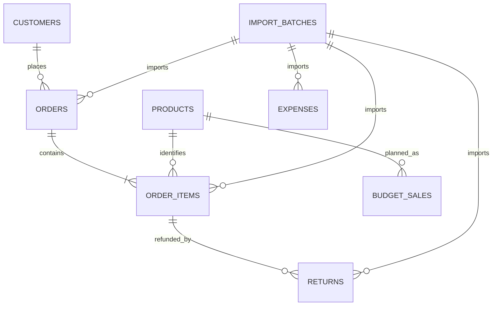

# 数据库设计（阶段2定稿 v1）

状态：本文件为阶段2设计成果，阶段3已据此编写SQL并在临时MySQL实际验证通过；用户也已在现有3306服务成功建立finance_bp_stage3。现按用途归入reference，旧路径对应关系见[路径变更表](../PATHS.md)。

## 1. 先理解一行数据代表什么

“粒度”就是一行代表的业务记录。不同粒度的数据必须先分别汇总，再比较或合并。

| 表 | 一行代表什么 | 为什么需要单独保存 |
|---|---|---|
| products | 一个商品 | 保存商品身份和分类 |
| customers | 一个模拟客户 | 同一客户可以多次购买 |
| orders | 一次订单 | 保存客户、日期、状态、渠道、区域 |
| order_items | 一个订单中的一条商品明细 | 一个订单可包含多种商品，数量价格不同 |
| returns | 一条明细的一次已确认退款 | 同一商品明细可有多次退款，日期不同 |
| expenses | 一笔费用明细 | 费用不会随订单连接而重复累计 |
| dim_date | 一个自然日 | 补齐月份并支持同比环比 |
| import_batches | 一类数据的一个文件内容的导入生命周期 | 防重复、记录失败与重试 |
| budget_sales | 一个版本×月×商品×渠道×区域 | 与同粒度实际销售比较 |
| budget_expenses | 一个版本×月×类别×部门×费用归属 | 费用使用自己的比较粒度 |

当前设计10张基础、实际、预算和管理表。forecast_runs、forecast_sales、forecast_expenses另有字段方案，合计规划13张表。阶段9实际采用本地JSON保存预测结果，三张预测表保留为后续专用结果库方案，尚未创建；来源MySQL保持只读。

完整的字段、类型、空值政策、示例、键和校验见[正式数据字典](data_dictionary.md)。本文件用于理解整体设计。

## 2. 表如何关联

主键唯一标识表中的一行，例如order_id；外键引用另一张表中已有的记录，例如order_items.order_id。

图展示主要关系。商品、客户、预算也记录导入批次；完整键关系在08中说明。日期表通过日期汇总连接，不为每个日期字段设置外键。费用在月度层独立汇总，不直接关联订单。

一条订单可以有多个商品明细，一条商品明细可以有多笔退款。业务要求有效订单有至少一条明细，但父表外键不能保证这一点，导入后还需校验。

## 3. 业务实例如何入表

订单O0001包含P001收纳盒和P002清洁刷：
- orders保存一行O0001，记录客户、销售确认日期、C01渠道和R01区域。
- order_items保存两行I0001、I0002，记录各商品数量、售价、折扣和历史成本。
- 如果I0001先后退款两次，returns保存两行T0001、T0002，均引用I0001。
- 退款经I0001关联到O0001，得到原商品、渠道和区域，按退款自己的日期归期。

**错误连接示例**：I0001收入550元，有两次退款；直接连接后会得到两行550元，若再求和就变成1100元。

**正确方法**：销售按销售确认月汇总；退款按退款月汇总；合并月×商品×渠道×区域的唯一结果。先建立键集合再左连接两侧，保留“只有退款、没有当月销售”的行。公司费用另算。

## 4. 关键设计决定

| 决定 | 理由 |
|---|---|
| 明细保存成交时成本快照 | 后来的采购成本不会改写历史毛利 |
| 退款增加recoverable_quantity | 区分实际退货和能够回库转回成本的数量 |
| 实际交易单价与金额使用DECIMAL(18,2) | 小样本和实际交易以分为单位；派生平均单价保留更多精度 |
| 预算/预测单位价格与成本使用DECIMAL(18,4) | 管理假设可用更细精度，金额汇总后按约定显示 |
| 原始交易金额保存为非负值 | 销售、退款的正负方向由分析定义；净收入仍可为负 |
| budget使用组合唯一键 | 相同版本、期间、维度只允许一条预算 |
| 实际共同费用归属用NULL，预算用ALL | 保留原草案约定；比较时明确把NULL映射为ALL |
| 所有正式导入数据保留批次 | 可追踪来源，重复导入不会再次累计 |
| 已确认历史交易不自动覆盖 | 不同文件中的同ID不同内容必须报告冲突 |
| 日期使用DATE | 第一版按日和月分析，不处理时区与小时 |
| 当前比例由金额计算，不在业务表重复保存 | 避免存储的毛利率与最新汇总不一致 |

相对原草案，import_batches从“一次尝试”细化为“一个文件内容的生命周期”，使用attempt_count记录重试，保留失败摘要；重复点击不生成另一份有效数据。各次详细运行日志在阶段5写入独立日志文件。

## 5. 校验由谁负责

数据库能限制主键重复、失效引用、必填值和同一行内的数值范围。跨表、累计与状态改变规则还需导入程序及SQL质量查询校验。

| 规则 | 设计上的执行位置 |
|---|---|
| quantity>0，金额>=0，折扣不超原价金额 | NOT NULL与CHECK |
| 退款必须引用已有明细 | 外键 |
| 已完成订单必须有确认日期 | 同行CHECK |
| 退款日期不早于原销售确认日期 | 导入校验+跨表质量查询 |
| 多次退款累计不超原金额/数量/成本 | 导入事务校验+累计质量查询 |
| 成本转回不超实际可回库数量对应成本 | recoverable_quantity、成本快照和跨表校验 |
| 订单至少有一条明细 | 导入完成校验 |
| completed不能因退款变成cancelled | 导入更新政策；退款独立记录 |
| 预算缺失与零预算区分 | 分析层保留缺失行，不自动填零 |

CHECK只能承担适合单行的规则，不能用它替代跨表退款累计校验；实际语法和约束执行会在阶段3根据本机版本确认。[MySQL CHECK说明](https://dev.mysql.com/doc/refman/8.4/en/create-table-check-constraints.html)

## 6. 编码与预算粒度

- 渠道：C01自营商城、C02平台商城、C03直播渠道。
- 区域：R01华东、R02华南、R03华北、R04西部。
- 商品类别：STORAGE收纳、CLEANING清洁、KITCHEN厨房用品。
- 状态：pending、completed、cancelled。
- 费用类别、部门、退款原因和批次状态在08中列出。
- 销售预算的唯一键：budget_version+month+product_id+channel_code+region_code。
- 费用预算的唯一键：budget_version+month+expense_category+department+channel_scope+region_scope。

例如2026年9月、商品P001、渠道C01、区域R01的实际与预算分别汇总后才比较。9月预算不能直接放到每条订单旁边再累加。

费用预算的每条记录是独立费用组；ALL只表示共同费用，不表示含其他费用行的总计。总计在查询中计算，不能再作为另一条预算事实插入。

## 7. 建表与导入顺序

1. dim_date、import_batches。
2. products、customers。
3. orders。
4. order_items。
5. returns、expenses。
6. budget_sales、budget_expenses。
7. 后续预测结果库：forecast_runs，再forecast_sales、forecast_expenses；阶段9当前使用本地不可覆盖JSON。

父表先于子表；小样本从3个商品和10个订单起步。业务外键采用RESTRICT，不通过删除商品或订单自动级联删除历史财务记录。[MySQL外键说明](https://dev.mysql.com/doc/refman/8.4/en/create-table-foreign-keys.html)

## 8. 从需求到字段

| 问题 | 关键表和字段 | 能支持的输出 |
|---|---|---|
| Q01收入毛利趋势 | recognized_date、refund_date、数量、价格、折扣、成本快照、退款、成本转回、日期表 | 月度收入毛利、同比环比 |
| Q02商品渠道区域贡献 | product_id/category、channel_code、region_code、月度实际与预算 | 排名、差异贡献 |
| Q03预算与PVM | 实际数量和折后收入、预算数量/单价、实际/预算退款 | 价格销量结构退款桥 |
| Q04全年预测 | 实际汇总、费用、cutoff_month、预测销量价格成本费用与假设 | 全年预测、预算差额 |
| Q05情景变化 | 基础预测run_id、scenario_name、assumptions_json、各未来驱动字段 | 情景结果和差额 |

Q01—Q03所需字段现在设计；Q04—Q05所需表在08中预留，阶段9以本地JSON实现其运行/销售/费用保存语义。

## 9. 设计核对与下一步

已完成字段字典、键关系、编码、索引、建表顺序和需求映射，并核对多次退款、成本快照、共同费用和预算粒度。数据库执行效果仍需阶段3通过小样本证明，不能将设计核对视为建表测试通过。

阅读[阶段2学习与下一步指南](../history/stages/09_阶段2学习与下一步.md)，先理解订单—明细—退款这条关系。下一项实际操作是阶段3：检查已有MySQL环境，编写建表SQL并导入小样本。
